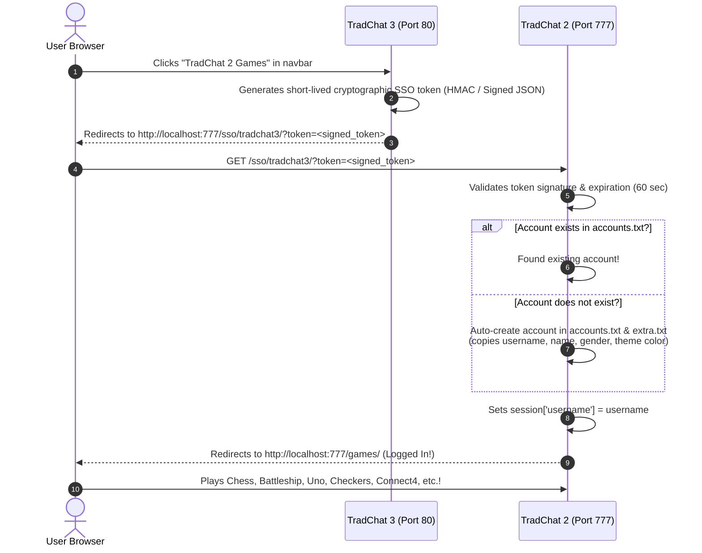

# TradChat 3 & 2 Seamless Games Connection & SSO Plan

This plan details how to connect **TradChat 3** and **TradChat 2** so users can click "Games" in TradChat 3, automatically log in to TradChat 2 (creating an account on TradChat 2 if one doesn't exist yet), and immediately start playing any of the multiplayer and classic games.

---

## 1. High-Level Architecture: How It Works

TradChat 3 and TradChat 2 are both Python Flask web applications running locally:
- **TradChat 3**: Primary modern app running on port `80` (or `8080`).
- **TradChat 2**: Classic games & chat app located at `/home/michael/Desktop/Michael/Tradchat`, running on port `777`.

Because browsers isolate cookies per port (`localhost:80` vs `localhost:777`), logging into TradChat 3 does not automatically log someone into TradChat 2. To bridge them seamlessly without asking the user to type their password again:



---

## 2. Key Components & Implementation Details

### A. The Cryptographic Handshake (SSO Token)
To prevent unauthorized users or spoofing, TradChat 3 and TradChat 2 will share a secret key (`TRADCHAT_SSO_SHARED_SECRET`).
When a logged-in user in TradChat 3 wants to play games:
1. TradChat 3 packages payload:
   ```python
   payload = {
       "username": session["username"],
       "first_name": user_data.get("first_name", ""),
       "last_name": user_data.get("last_name", ""),
       "gender": user_data.get("gender", "Neutral"),
       "theme_color": user_data.get("theme_color", "#808080"),
       "timestamp": int(time.time()),
       "target": "/games/"
   }
   ```
2. TradChat 3 signs this payload using `itsdangerous.URLSafeTimedSerializer` or an HMAC-SHA256 signature.
3. The token expires in **60 seconds**, ensuring it cannot be intercepted or replayed later.

### B. Auto-Provisioning in TradChat 2
TradChat 2 stores accounts in `accounts.txt` and `extra.txt` as Python dictionaries:
- `accounts.txt` format:
  ```python
  accounts[username] = [
      password_hash_or_random, # password
      gender,                  # "Boy" / "Girl" / "Neutral"
      color_hex,               # e.g. "#4a8505"
      join_date_iso,           # "YYYY-MM-DD"
      first_name,              # First Name
      last_name,               # Last Name
      "Room 1",                # default room
      email,                   # email
      geo_dict                 # location metadata
  ]
  ```
- `extra.txt` format:
  ```python
  extra[username] = {
      "bell": [],
      "JoiningDate": "YYYY-MM-DD",
      "lastVisit": "YYYY-MM-DD",
      "color": color_hex,
      "notifications": []
  }
  ```

When TradChat 2 receives the valid SSO token:
1. It inspects `accounts = load_file('accounts.txt')`.
2. If `username` already exists: It can optionally update the profile color/name to match TradChat 3.
3. If `username` does **not** exist:
   - It generates a secure random password (or synced password hash).
   - Inserts the new entry into `accounts.txt` and `extra.txt`.
   - Saves both files safely.
4. It initializes the TradChat 2 session:
   ```python
   session['username'] = username
   return redirect(url_for('games'))
   ```

---

## 3. TradChat 2 Available Games Catalog

TradChat 2 already has a rich catalog of working games:
- ♟️ **Chess** (`/games/chess/` with `sunfish` engine and 2-player support)
- 🚢 **Battleship** (`/games/battleship/`)
- 🏁 **Checkers** (`/games/checkers/`)
- 🔴 **Connect 4** (`/games/connect4/`)
- ⚔️ **Conquest** (`/games/conquest/`)
- ⚫ **Othello / Reversi** (`/games/othello/`)
- ⭕ **Tic-Tac-Toe** (`/games/ttt/`)
- 🃏 **Uno** (`/games/uno/`)
- 🎲 **Yahtzee** (`/games/yahtzee/`)
- 🎮 **Custom Game Engines / Questions 20** (`cge.py`, `questions20.html`)

---

## 4. UI / Integration Options for TradChat 3

We can integrate the games experience in three different ways:

### Option 1: Direct SSO Launch (Recommended & Simplest)
- In TradChat 3 navbar, clicking **Games** directly triggers `/launch-games/`.
- Opens `http://localhost:777/games/` in either the current tab or a new tab.
- At the top of TradChat 2's `games.html`, we add a clean, friendly button: **"← Back to TradChat 3"** (which links to `http://localhost:80/feed/` or `http://localhost/`).

### Option 2: Embedded Arcade Window (Inside TradChat 3)
- TradChat 3 keeps its navbar and page header, and embeds TradChat 2 inside a full-height `<iframe>` on a new `data-page="games"` section.
- Gives a 100% unified look: users never feel like they left TradChat 3.
- (Requires TradChat 2 to not block `X-Frame-Options` or to set `SAMEORIGIN`/allow `localhost`).

### Option 3: Modern Game Hub Cards in TradChat 3
- TradChat 3 shows beautiful cards for each game:
  - Card 1: **Chess** ("Challenge AI or a friend") -> launches directly to `http://localhost:777/sso/tradchat3/?game=chess`
  - Card 2: **Battleship** -> launches directly to `http://localhost:777/sso/tradchat3/?game=battleship`
  - Card 3: **Uno**, etc.
- Clicking any card logs the user in and lands them straight on that specific game table!

---

## 5. Dual-Server Management: Running Both Together

To make development and running painless, we can provide a small launcher script:
- `run_tradchat.sh` (or a Python launcher `run_ecosystem.py`) that:
  1. Checks if TradChat 2 is running on port 777; if not, starts it.
  2. Starts TradChat 3 on port 80.
  3. Gracefully handles stopping both when you press `Ctrl+C`.

---

## 6. Implementation Steps

1. **Shared Token Utility**:
   - Create a clean helper module (e.g., `sso_bridge.py`) in both repositories or shared location that handles HMAC token creation and verification with expiration timestamps.
2. **TradChat 3 Endpoints & Navbar**:
   - Add `/sso/launch-games/` route in TradChat 3 `Server.py`.
   - Update navbar link in `templates/tradchat.html` to point to games launcher.
3. **TradChat 2 SSO Receiver & Auto-Provisioning**:
   - In `/home/michael/Desktop/Michael/Tradchat/Server.py`, add `@app.route('/sso/tradchat3/')`.
   - Add verification and auto-creation in `accounts.txt` / `extra.txt`.
   - Add a "← Return to TradChat 3" top bar in TradChat 2 `games.html`.
4. **Verification & Testing**:
   - Create a test user in TradChat 3 that does not exist in TradChat 2.
   - Click "Games" / trigger SSO endpoint.
   - Verify that TradChat 2 automatically creates the user record in `accounts.txt`.
   - Verify session authentication and that the user lands on `/games/` successfully.
